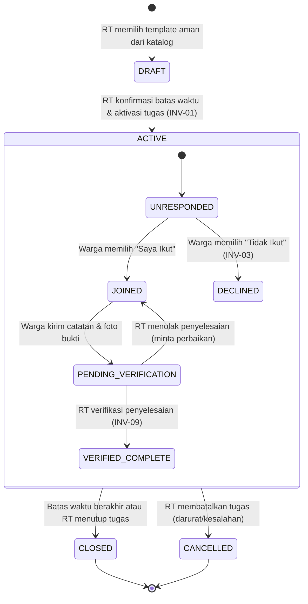
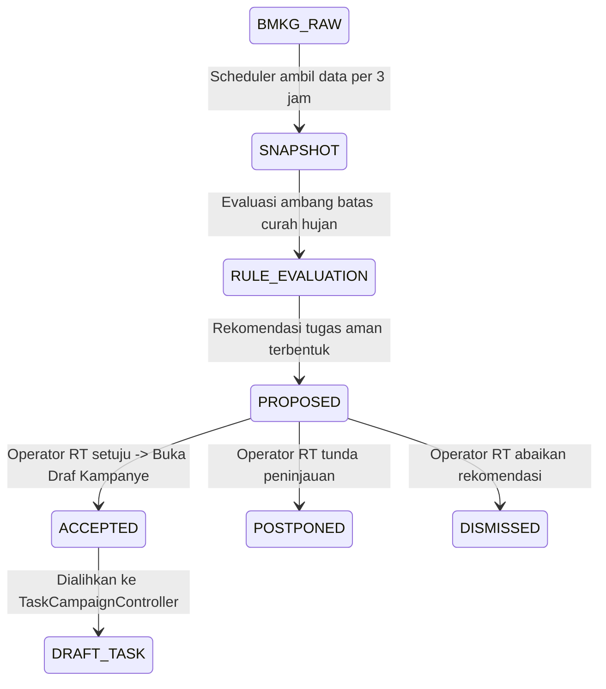
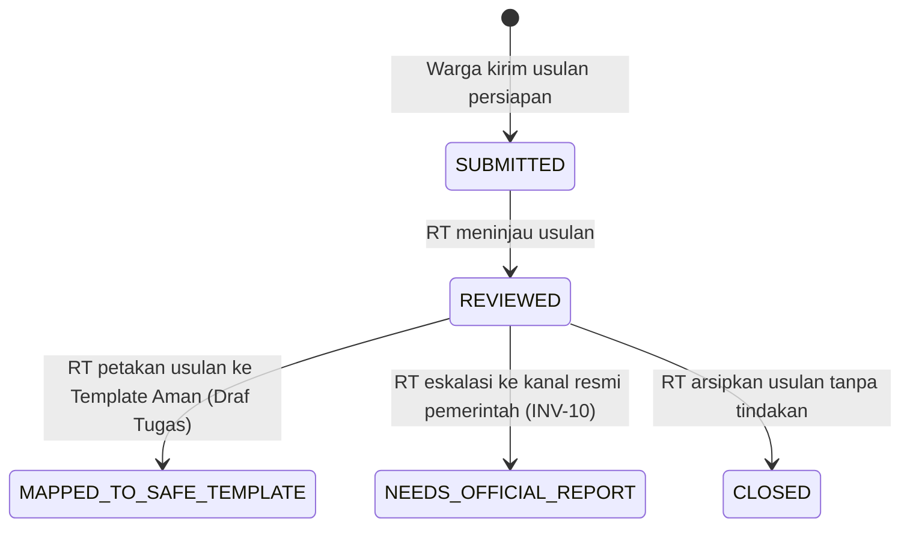

# DOKUMEN AUDIT MENYELURUH & PERENCANAAN REDESIGN GUYUB.ID
**Dokumen Arsitektur, Audit Sistem, dan Rencana Pengembangan UI/UX**
*Status: FASE AUDIT & PERENCANAAN (Read-Only)*
*Tanggal Audit: 17 Oktober 2026*
*Target Repositori: `d:\project\guyub`*

---

## DAFTAR ISI
1. [LANGKAH 1 — Inventaris Sumber Daya & Arsitektur Repositori](#langkah-1--inventaris-sumber-daya--arsitektur-repositori)
2. [LANGKAH 2 — Role, Hak Akses & Matriks Aktor Sistem](#langkah-2--role-hak-akses--matriks-aktor-sistem)
3. [LANGKAH 3 — Matriks Fitur Lengkap (Backend vs UI)](#langkah-3--matriks-fitur-lengkap-backend-vs-ui)
4. [LANGKAH 4 — Flow Bisnis End-to-End & State Machine](#langkah-4--flow-bisnis-end-to-end--state-machine)
5. [LANGKAH 5 — Investigasi Khusus: Fitur Peta & "Titik Pohon"](#langkah-5--investigasi-khusus-fitur-peta--titik-pohon)
6. [LANGKAH 6 — Audit UI Saat Ini vs Desain Proposal (Root Cause Analysis)](#langkah-6--audit-ui-saat-ini-vs-desain-proposal-root-cause-analysis)
7. [LANGKAH 7 — Rancangan Beranda RT & Pola Kartu Bersih (Clean Cards)](#langkah-7--rancangan-beranda-rt--pola-kartu-bersih-clean-cards)
8. [LANGKAH 8 — Rencana Eksekusi Bertahap (Execution Plan)](#langkah-8--rencana-eksekusi-bertahap-execution-plan)
9. [LANGKAH 9 — Daftar Pertanyaan & Keputusan untuk Pengguna](#langkah-9--daftar-pertanyaan--keputusan-untuk-pengguna)

---

## LANGKAH 1 — Inventaris Sumber Daya & Arsitektur Repositori

### 1.1 Pohon Direktori & Ringkasan Fungsi Folder

```text
guyub/
├── android/                   # Konfigurasi native Android (Gradle, permissions, network security)
├── assets/                    # Aset visual aplikasi (ikon, ilustrasi, logo)
├── docs/                      # Dokumentasi spesifikasi, Master PRD, rencana implementasi & traceability
│   ├── figma_export/          # Aset visual & screen proposal Figma
│   ├── GUYUB_ID_MASTER_PRD_ENGINEERING_SPEC.md # Kontrak arsitektur & invarian produk
│   ├── IMPLEMENTATION_PLAN.md # Rencana tahapan implementasi teknik MVP
│   ├── REQUIREMENTS_TRACEABILITY.md # Pemetaan kebutuhan fungsional (FR) ke kode
│   └── TEST_ACCEPTANCE_MATRIX.md # Matriks kriteria penerimaan pengujian (AT)
├── functions/                 # Backend Firebase Cloud Functions v2 (Node.js 20)
│   ├── src/                   # Domain logic, callable functions, scheduled jobs, repository adapter
│   └── test/                  # Automated integration tests backend (Firestore/Functions emulator)
├── lib/                       # Kode sumber aplikasi Flutter (Clean Architecture / Feature-Driven)
│   ├── app/                   # Root application, routing, bootstrap, dependency injection
│   ├── core/                  # Core abstractions (theme, result types, config, network, shared widgets)
│   └── features/              # Fitur modular (auth, tasks, weather, assistance, proposals, emergency, notifications)
├── test/                      # Pengujian unit, widget, dan integrasi Flutter (233 tests passing)
├── tool/                      # Skrip automasi verifikasi, seeding emulator, dan uji Firestore rules
├── firestore.indexes.json     # Definisi composite index Firestore untuk query kompleks
├── firestore.rules            # Keamanan database Firestore (fail-closed, strictly scoped)
├── storage.rules              # Keamanan cloud storage bukti foto (30-day retention, sanitized JPEG)
└── pubspec.yaml               # Manajemen dependensi Flutter SDK & library pihak ketiga
```

* **`docs/`**: Berisi fondasi produk (`GUYUB_ID_MASTER_PRD_ENGINEERING_SPEC.md`), memuat 10 invarian produk non-negosiasi, batasan privasi data warga, dan matriks penerimaan.
* **`functions/`**: Backend serverless yang menjadi batas otorisasi utama (`authorization boundary`). Semua mutasi penting (kampanye, verifikasi tugas, sesi warga, direktori darurat) diverifikasi di sini.
* **`firestore.rules`**: Mengimplementasikan kebijakan keamanan database strictly fail-closed. Hanya dokumen operator aktif milik sendiri (`/operators/{uid}`) yang dapat diakses langsung oleh klien; semua koleksi lain ditolak (`allow read, write: if false`) dan wajib melalui Cloud Functions.
* **`storage.rules`**: Membatasi unggahan bukti foto ke format JPEG di bawah 2 MB dan menolak akses publik langsung.
* **`firestore.indexes.json`**: Menyediakan composite index untuk query filter multikolom (seperti `rtId` + `status` + `deadline` pada kampanye tugas, dan query riwayat).
* **`tool/`**: Berisi script otomasi `verify.sh` (format, analyze, test, build), seed data emulator operator (`seed_operator.js`) dan warga (`seed_warga.js`).
* **`lib/core/`**: Menyediakan tema konsisten (`AppTheme`, `AppColors`), tipe `Result`, pemantau konektivitas, konfigurasi runtime (`AppConfig`), dan shared components (`TintedInfoBox`, `TaskCategoryPresentation`, `SectionCard`, `InfoRow`).
* **`lib/features/`**: Terdiri dari 7 modul fitur vertikal:
  * `auth`: Login email/password operator RT dan pembuatan/restorasi sesi warga dengan kode RT.
  * `tasks`: Katalog tugas aman, pembuatan draf, aktivasi, respon partisipasi warga, unggah bukti foto, dan verifikasi operator.
  * `weather`: Penarikan snapshot BMKG otomatis, rule engine saran tugas, dan peninjauan operator.
  * `emergency`: Direktori darurat offline-first (kontak, titik kumpul, kanal pelaporan resmi).
  * `assistance`: Manajemen warga rentan (proxy registration) dan relawan pendamping.
  * `proposals`: Pengajuan usulan persiapan oleh warga dan konversi menjadi draf tugas aman oleh RT.
  * `notifications`: Integrasi FCM untuk pemberitahuan kampanye tugas dengan kebijakan jendela waktu aman.

---

### 1.2 Skema Koleksi & Dokumen Database (Firestore)

Ditemukan 16 koleksi utama di `functions/src/` dan `docs/GUYUB_ID_MASTER_PRD_ENGINEERING_SPEC.md §12`:

| Nama Koleksi | File Sumber Backend | Fungsi Dokumen & Kolom Kunci |
|:---|:---|:---|
| `rt_communities` | `firestore_resident_session_repository.js` | Metadata komunitas RT: `rtId`, `displayName`, `rtLabel`, `joinCodeHash`, `joinCodeActive`. |
| `operators` | `firestore_task_campaign_repository.js` | Profil akun operator RT: `operatorUid`, `rtId`, `role` (`KETUA_RT_RW`/`PENDAMPING_RT`), `active`, `displayName`. |
| `task_templates` | `firestore_task_campaign_repository.js` | Master template tugas aman: `templateId`, `version`, `title`, `category`, `coreInstruction`, `safetyInstruction`, `estimatedDurationMinutes`, `enabled`, `reviewStatus`. |
| `task_campaigns` | `firestore_task_campaign_repository.js` | Kampanye tugas aktif/riwayat per RT: `campaignId`, `rtId`, `status` (`DRAFT`/`ACTIVE`/`CLOSED`/`CANCELLED`), `templateSnapshot`, `locationReference`, `activatedAt`, `deadline`. |
| `task_responses` | `firestore_task_response_repository.js` | Respon warga atas tugas: `rtId_taskId_residentId`, `participation` (`JOIN`/`DECLINE`), `completion` (`PENDING_VERIFICATION`/`VERIFIED`), `completionNote`, `evidenceId`. |
| `task_evidence` | `firestore_task_evidence_repository.js` | Metadata foto bukti pengerjaan: `evidenceId`, `rtId`, `taskId`, `storagePath`, `sanitizedSha256`, `createdAt`, `purgeAfter` (retensi 30 hari). |
| `resident_sessions` | `firestore_resident_session_repository.js` | Sesi token warga: `sessionIdHash`, `communityId`, `residentId`, `expiresAt`, `revokedAt`. |
| `resident_profiles` | `firestore_proxy_resident_repository.js` | Data warga di RT: `residentId`, `rtId`, `nickname`, `houseNumberOptional`, `needsAssistance`, `assistanceMarker`, `willingToHelp`, `createdBy` (`self`/`proxy`). |
| `assistance_assignments`| `firestore_assistance_assignment_repository.js`| Penugasan relawan ke warga rentan: `assignmentId`, `rtId`, `residentNeedingHelpId`, `helperResidentId`, `state` (`PROPOSED`/`ACCEPTED`/`DECLINED`). |
| `resident_proposals` | `firestore_resident_proposal_repository.js` | Usulan warga: `proposalId`, `rtId`, `residentId`, `title`, `description`, `category`, `locationReference`, `state` (`SUBMITTED`/`REVIEWED`/`DRAFTED`). |
| `weather_sources` | `firestore_weather_suggestion_repository.js` | Konfigurasi sumber BMKG: `rtId`, `adm4Code`, `enabled`. |
| `weather_snapshots` | `firestore_weather_suggestion_repository.js` | Snapshot prakiraan BMKG: `snapshotId`, `rtId`, `source`, `sourceUpdatedAt`, `rainfallMm`, `fetchedAt`. |
| `weather_last_valid_snapshots` | `firestore_weather_suggestion_repository.js` | Pointer snapshot valid terakhir per RT: `rtId`, `snapshotId`, `rainfallMm`, `sourceUpdatedAt`. |
| `weather_suggestions`| `firestore_weather_suggestion_repository.js` | Saran tugas hasil evaluasi cuaca: `suggestionId`, `rtId`, `templateId`, `state` (`PROPOSED`/`ACCEPTED`/`POSTPONED`/`DISMISSED`), `ruleTriggered`. |
| `emergency_directories`| `firestore_emergency_directory_repository.js`| Direktori RT: `rtId`, `state`, `version`, `emergencyContacts[]`, `assemblyPoints[]`, `officialReportChannels[]`, `lastVerifiedAt`. |
| `task_notification_events`| `firestore_task_notification_repository.js`| Antrean pengiriman push notification FCM: `eventId`, `rtId`, `campaignId`, `eventType`, `status` (`PENDING`/`SENT`/`FAILED`). |
| `audit_events` | `firestore_task_campaign_repository.js` | Log audit kepatuhan tanpa data pribadi: `auditId`, `eventType`, `actor`, `rtId`, `occurredAt`. |

---

## LANGKAH 2 — Role, Hak Akses & Matriks Aktor Sistem

### 2.1 Identifikasi Seluruh Role & Aktor

1. **Ketua RT/RW (`OperatorRole.ketuaRtRw`)**:
   * **Cara Masuk**: Firebase Authentication Email & Password (`/operator/login`).
   * **Claim/Membership**: Dokumen `/operators/{uid}` dengan `active: true` dan `role: 'KETUA_RT_RW'`.
   * **Kewenangan Backend**: Otorisasi penuh dalam batas RT (`rtId`): aktivasi draf tugas, penutupan/pembatalan tugas, verifikasi pengerjaan warga, konversi usulan warga, penugasan relawan.
   * **Layar yang Diakses**: `/operator/home`, `/operator/tasks/catalog`, `/operator/tasks/confirmation`, `/operator/tasks/active`, `/operator/tasks/history`, `/operator/tasks/verification`, `/operator/proposals`, `/operator/proxy-residents`, `/operator/weather-suggestions`.
   * **Gap UI**: Beranda saat ini hanya tumpukan tombol vertikal (belum berupa dashboard metrik, tugas terkini, cuaca, dan kartu aksi cepat).

2. **Pendamping RT (`OperatorRole.pendampingRt`)**:
   * **Cara Masuk**: Firebase Authentication Email & Password (`/operator/login`).
   * **Claim/Membership**: Dokumen `/operators/{uid}` dengan `active: true` dan `role: 'PENDAMPING_RT'`.
   * **Kewenangan Backend**: Setara dengan operator operasional; fokus pada koordinasi warga rentan, menerima push notification tugas untuk pendampingan.
   * **Layar yang Diakses**: Sama dengan Ketua RT, ditambah opt-in FCM khusus token perangkat pendamping (`TaskPushOptInCard`).

3. **Warga Mandiri (`ResidentSession`)**:
   * **Cara Masuk**: Input Kode RT aktif (mis. `GUYUBRT01DEMO`) + Nama Panggilan mandiri (`/resident/entry`). Tidak menggunakan password/email.
   * **Claim/Membership**: Token sesi kriptografis terenkripsi (`sessionToken`) disimpan di FlutterSecureStorage; divalidasi server melalui hash SHA-256 (`sessionIdHash`).
   * **Kewenangan Backend**: Partisipasi sukarela (`joinTask`, `declineTask`), kirim catatan singkat pengerjaan & unggah 1 foto bukti opsional (disanitasi), pengajuan usulan persiapan, membaca direktori darurat, opt-in/opt-out kesediaan membantu sesama warga.
   * **Layar yang Diakses**: `/resident/home` (Tab Beranda, Tugas, Darurat), `/resident/tasks/detail`, `/resident/proposal`, `/resident/assistance`.

4. **Relawan Warga / Helper (`willingToHelp == true`)**:
   * **Cara Masuk**: Merupakan bagian dari sesi warga yang mengaktifkan opsi "Kesediaan Membantu" (`/resident/assistance`).
   * **Kewenangan Backend**: Menerima penugasan bantuan dari RT, konfirmasi kesediaan (`ACCEPTED`/`DECLINED`/`WITHDRAWN`), melaporkan status bantuan.
   * **Gap UI**: Layar respons penugasan relawan telah ada di [assistance_volunteer_screen.dart](file:///d:/project/guyub/lib/features/assistance/presentation/assistance_volunteer_screen.dart), namun belum ada visual kartu interaktif di Beranda Warga jika ada permintaan bantuan masuk.

5. **Warga Rentan / Membutuhkan Bantuan (Proxy Resident)**:
   * **Cara Masuk**: Tidak memiliki akun langsung; didaftarkan oleh RT/Pendamping (`ProxyResidentScreen`).
   * **Kewenangan Backend**: Profil tersimpan dengan penanda kebutuhan bantuan (`assistanceMarker`: lansia, balita, disabilitas, kondisi kesehatan), tanpa menyimpan rekam medis atau alamat lengkap.
   * **Layar UI**: Dikelola oleh operator via [proxy_resident_screen.dart](file:///d:/project/guyub/lib/features/assistance/presentation/proxy_resident_screen.dart).

6. **Sistem / Scheduled Automation (Cloud Scheduler)**:
   * **Aktor**: `cron` scheduler di Cloud Functions (`functions/src/index.js`):
     * Penarikan otomatis BMKG cuaca (setiap 3 jam).
     * Pembersihan otomatis foto bukti kadaluwarsa (setiap 24 jam untuk foto > 30 hari).
     * Pengiriman jendela notifikasi push tugas.
   * **UI**: Tidak ada (bekerja di latar belakang server).

7. **Administrator Platform / Tim Guyub.id**:
   * **Status**: **TIDAK MEMILIKI UI DI APLIKASI MOBILE**.
   * **Kewenangan**: Memasukkan template master tugas aman ke `task_templates` dan membuat akun operator RT baru. Dilakukan melalui backend script/Firebase Console demi mematuhi batas invariant keamanan.

---

## LANGKAH 3 — Matriks Fitur Lengkap (Backend vs UI)

| Fitur Produk | Role Terkait | Backend (Koleksi / Callable Function / Rules) | Application Layer (Entity / Boundary / Controller) | Layar UI Aktual | Status UI Saat Ini | Butuh Perubahan Backend? |
|:---|:---|:---|:---|:---|:---:|:---:|
| **Auth & Manajemen Sesi Operator** | Ketua RT/RW, Pendamping | `operators/{uid}`, Firebase Auth, `firestore.rules` | `OperatorProfile`, `FirebaseOperatorAuthBoundary` | [operator_login_screen.dart](file:///d:/project/guyub/lib/features/auth/presentation/screens/operator_login_screen.dart) | **SUDAH DIREDESIGN** | Tidak |
| **Auth & Sesi Warga (Kode RT)** | Warga | `rt_communities`, Callable `createResidentSession`, `validateResidentSession` | `ResidentSession`, `ResidentSessionController`, `FlutterSecureResidentSessionVault` | [resident_entry_screen.dart](file:///d:/project/guyub/lib/features/auth/presentation/screens/resident_entry_screen.dart) | **SUDAH DIREDESIGN** | Tidak |
| **Katalog Template Tugas Aman** | Ketua RT/RW, Pendamping | `task_templates`, Callable `listApprovedTaskTemplates` | `TaskTemplate`, `TaskCampaignController` | [task_catalog_screen.dart](file:///d:/project/guyub/lib/features/tasks/presentation/screens/task_catalog_screen.dart) | **ADA TAPI POLOS** | Tidak |
| **Draf & Konfirmasi Aktivasi Tugas** | Ketua RT/RW | `task_campaigns`, Callable `createTaskDraft`, `activateTaskCampaign` | `TaskCampaignRecord`, `TaskCampaignController` | [task_campaign_confirmation_screen.dart](file:///d:/project/guyub/lib/features/tasks/presentation/screens/task_campaign_confirmation_screen.dart) | **ADA TAPI RUSAK / POLOS** *(Bug 6d: warna kontras & tanggal Inggris)* | Tidak |
| **Pemantauan Tugas Aktif RT** | Ketua RT/RW, Pendamping | `task_campaigns`, Callable `listActiveTaskCampaigns`, `cancelTaskCampaign` | `ActiveTaskCampaignRecord`, `TaskCampaignController` | [task_active_campaigns_screen.dart](file:///d:/project/guyub/lib/features/tasks/presentation/screens/task_active_campaigns_screen.dart) | **ADA TAPI RUSAK** *(Bug 6e: error serialisasi seed)* | Tidak *(hanya perbaikan seed)* |
| **Riwayat Tugas RT & Lifecycle** | Ketua RT/RW, Pendamping | `task_campaigns`, Callable `listRtTaskHistory`, `listTaskLifecycleEvents` | `RtTaskHistoryPage`, `TaskCampaignController` | [task_history_screen.dart](file:///d:/project/guyub/lib/features/tasks/presentation/screens/task_history_screen.dart) | **ADA TAPI POLOS** | Tidak |
| **Daftar Tugas Warga (Tarik/Sinkron)** | Warga | `task_campaigns`, Callable `listResidentActiveTasks` | `ResidentTaskList`, `TaskResponseController`, `ResidentTaskOfflineStore` | [task_response_screens.dart](file:///d:/project/guyub/lib/features/tasks/presentation/screens/task_response_screens.dart) (`ResidentTaskListScreen`) | **SUDAH DIREDESIGN** | Tidak |
| **Detail Tugas & Respon Partisipasi** | Warga | `task_responses`, Callable `recordTaskParticipation` | `ResidentTaskRecord`, `TaskResponseController` | [task_response_screens.dart](file:///d:/project/guyub/lib/features/tasks/presentation/screens/task_response_screens.dart) (`ResidentTaskDetailScreen`) | **SUDAH DIREDESIGN** *(perlu polish kartu)* | Tidak |
| **Penyelesaian & Upload Bukti Foto** | Warga | `task_evidence`, Storage bucket, Callable `submitTaskCompletion`, `uploadTaskEvidence` | `EvidenceImageSanitizer`, `TaskResponseController` | [task_response_screens.dart](file:///d:/project/guyub/lib/features/tasks/presentation/screens/task_response_screens.dart) | **SUDAH DIREDESIGN** | Tidak |
| **Verifikasi Tugas oleh RT** | Ketua RT/RW | `task_responses`, Callable `listPendingTaskCompletions`, `verifyTaskCompletion` | `PendingTaskCompletionRecord`, `TaskResponseController` | [task_verification_queue_screen.dart](file:///d:/project/guyub/lib/features/tasks/presentation/screens/task_verification_queue_screen.dart) | **ADA TAPI POLOS** | Tidak |
| **Usulan Tugas oleh Warga** | Warga | `resident_proposals`, Callable `submitResidentProposal` | `ResidentProposalRecord`, `ResidentProposalController` | [resident_proposal_screen.dart](file:///d:/project/guyub/lib/features/proposals/presentation/resident_proposal_screen.dart) | **SUDAH DIREDESIGN** | Tidak |
| **Tinjauan & Konversi Usulan RT** | Ketua RT/RW | `resident_proposals`, Callable `listResidentProposals`, `reviewResidentProposal` | `ResidentProposalQueueRecord`, `ResidentProposalReviewController` | [resident_proposal_review_screen.dart](file:///d:/project/guyub/lib/features/proposals/presentation/resident_proposal_review_screen.dart) | **ADA TAPI POLOS** | Tidak |
| **Cuaca BMKG & Rekomendasi Tugas** | Ketua RT/RW, Pendamping | `weather_snapshots`, `weather_suggestions`, Callable `listWeatherSuggestions` | `WeatherSnapshot`, `WeatherSuggestion`, `WeatherSuggestionBoundary` | [weather_suggestion_review_screen.dart](file:///d:/project/guyub/lib/features/weather/weather_suggestion_review_screen.dart) | **ADA TAPI POLOS** | Tidak |
| **Direktori Darurat (Offline-First)** | Warga, Publik | `emergency_directories`, Callable `getEmergencyDirectory` | `EmergencyDirectory`, `EmergencyDirectoryController`, `EmergencyDirectoryCache` | [emergency_directory_screen.dart](file:///d:/project/guyub/lib/features/emergency/presentation/emergency_directory_screen.dart) | **SUDAH DIREDESIGN** *(koreksi empty state saat tanpa session)* | Tidak |
| **Dukungan Warga Rentan (Proxy)** | Ketua RT/RW, Pendamping | `resident_profiles`, Callable `listProxyResidents`, `createProxyResident` | `ProxyResidentProfile`, `ProxyResidentController` | [proxy_resident_screen.dart](file:///d:/project/guyub/lib/features/assistance/presentation/proxy_resident_screen.dart) | **ADA TAPI RUSAK** *(Bug 6e)* | Tidak |
| **Relawan Antar-Warga (Gotong Royong)**| Warga, RT | `assistance_assignments`, Callable `getVolunteerData`, `updateVolunteerConsent` | `ResidentVolunteerData`, `AssistanceVolunteerController` | [assistance_volunteer_screen.dart](file:///d:/project/guyub/lib/features/assistance/presentation/assistance_volunteer_screen.dart) | **ADA TAPI POLOS** | Tidak |
| **Push Notification Tugas (FCM)** | Pendamping, Warga | `task_notification_events`, FCM Topics, Callable `registerPendampingDeviceToken` | `TaskPushNotificationsController`, `FirebaseMessaging` | [task_push_opt_in_card.dart](file:///d:/project/guyub/lib/features/notifications/presentation/task_push_opt_in_card.dart) | **ADA TAPI POLOS** | Tidak |
| **Beranda RT / Ruang Operator** | Ketua RT/RW, Pendamping | Agregasi data dari seluruh callable di atas | Berbagai controller | [operator_home_screen.dart](file:///d:/project/guyub/lib/features/auth/presentation/screens/operator_home_screen.dart) | **ADA TAPI RUSAK / POLOS** *(Bug 6f: tumpukan tombol)* | Tidak |
| **Fitur Peta / Titik Pohon** | Warga | **TIDAK ADA** | **TIDAK ADA** | **TIDAK ADA** | **BELUM ADA** | **YA (butuh entity, model, dan endpoints)** |

---

## LANGKAH 4 — Flow Bisnis End-to-End & State Machine

### 4.1 State Machine Kampanye Tugas (RT & Warga)



* **Invarian Produk yang Mengikat**:
  * `INV-01`: Tidak ada tugas yang terbit otomatis dari cuaca. Harus lewat persetujuan RT (`DRAFT -> ACTIVE`).
  * `INV-02`: Judul dan instruksi keselamatan terkunci (`LockedTaskInstructionsCard`).
  * `INV-03`: Partisipasi sukarela. Menolak tugas tidak menimbulkan penalti.
  * `INV-07`: Bukti foto JPEG disanitasi (lokasi GPS dan metadata EXIF dihapus sebelum disimpan).
  * `INV-09`: Status selesai resmi hanya berlaku setelah diverifikasi oleh operator RT.

---

### 4.2 State Machine Rekomendasi Cuaca BMKG



* **Titik Putus UI Saat Ini**: Saat RT menekan "Terima" pada saran cuaca di `WeatherSuggestionReviewScreen`, alur membuka draf tugas, namun navigasi belum terhubung mulus kembali ke Beranda RT jika draf dibatalkan.

---

### 4.3 State Machine Usulan Warga ke RT



* **Invarian Terkait**: `INV-08` (Teks usulan warga tidak pernah menjadi instruksi tugas langsung; RT wajib memetakannya ke template katalog aman).

---

## LANGKAH 5 — Investigasi Khusus: Fitur Peta & "Titik Pohon"

### 5.1 Temuan Investigasi (Fakta Kode & Dokumen)

1. **Hasil Pencarian**:
   * Kata kunci `pohon`, `tree`, `vegetasi`, `vegetation`: **TIDAK DITEMUKAN** di seluruh dokumen (`docs/`), Cloud Functions (`functions/`), Firestore rules, skema koleksi, model Flutter, maupun aset proposal.
   * Kata kunci `GeoPoint`, `lat`, `lng`, `latitude`, `longitude`: **TIDAK DIGUNAKAN UNTUK MENYIMPAN TITIK LOKASI**. Sebaliknya, ditemukan di [functions/src/precise_coordinate_detector.js](file:///d:/project/guyub/functions/src/precise_coordinate_detector.js) yang **SECARA EKSPLISIT MENDETEKSI DAN MEMBLOKIR/MENOLAK KOORDINAT GPS DAN ALAMAT RUMAH TANGGA** demi kepatuhan privasi warga.
   * Kata kunci `peta` / `map`: Hanya muncul dalam dokumen proposal riset (`docs/MAGE 12...md`) yang merujuk pada platform eksternal pemerintah/publik (seperti *PetaBencana.id* dan *InaRISK BNPB*), dan bukan fitur peta internal aplikasi Guyub.id.
   * Kata kunci `lokasi` / `TaskLocationReferences`: Dibatasi secara kasar (coarse enum) pada 2 nilai aman: `'COMMUNITY_GENERAL_AREA'` ("Area umum RT yang ditentukan operator") dan `'HOUSEHOLD'` ("Rumah masing-masing"). Teks bebas dilarang di backend.
   * Kata kunci `assemblyPoints`: Ditemukan pada direktori darurat (`emergency_directories`), tetapi bertipe teks deskriptif: `label` (nama tempat) dan `publicLocation` (deskripsi alamat publik, mis. *"Balai Warga RT 01"*), **bukan koordinat koordinat geospasial**.

2. **Kesimpulan**:
   * **Fitur "titik pohon di peta" TIDAK PERNAH DIDEFINISIKAN atau DIBUAT di backend, rules, maupun spesifikasi Master PRD Guyub.id saat ini.**
   * Kemungkinan fitur ini adalah ide konsep lisan dari anggota tim atau salah paham antara pelaporan pohon rawan tumbang dengan katalog tugas drainase/lingkungan.

3. **Batasan Privasi Kritis (Invariant Produk INV-05)**:
   * *Master PRD §4 INV-05*: *"No forbidden personal data. Do not add NIK, full residential address, or precise resident GPS fields."*
   * Jika peta diimplementasikan, **DILARANG MENAMPILKAN TITIK KOORDINAT RUMAH TANGGA / WARGA**.
   * Peta HANYA boleh menampilkan fasilitas umum tingkat lingkungan: **Titik Kumpul Evakuasi RT**, Pos Ronda/Balai Warga, atau fasilitas umum non-pribadi.

### 5.2 Opsi Rekomendasi Peta untuk Flutter (Offline-Tolerant)

| Opsi Library | Kelebihan | Kekurangan / Risiko | Kebutuhan API Key / Biaya | Toleransi Offline | Rekomendasi |
|:---|:---|:---|:---|:---|:---:|
| **`flutter_map` + OpenStreetMap (OSM)** | Open-source, fleksibel, rendering ringan via Canvas, mendukung caching tile lokal. | Perlu konfigurasi local tile cache atau mbtiles agar dapat dibuka saat tanpa internet. | **GRATIS**, tanpa API key komersial. | **SANGAT TINGGI** (dapat preload tile wilayah RT). | **SANGAT DIREKOMENDASIKAN** |
| **`google_maps_flutter`** | Tampilan familiar, integrasi bawaan Google Play Services. | Bergantung koneksi internet untuk fetch tile, konsumsi memori tinggi, rawan gagal saat koneksi terputus. | Butuh Google Cloud API Key, potensi biaya pay-as-you-go jika kuota terlewati. | **RENDAH** (tile Google Maps tidak mudah dicache offline legal). | Tidak disarankan untuk kondisi darurat banjir |

---

## LANGKAH 6 — Audit UI Saat Ini vs Desain Proposal (Root Cause Analysis)

### 6.1 Status Redesign Seluruh Screen / Route

| Route | Layar / Widget | Status | Catatan Audit |
|:---|:---|:---:|:---|
| `/` | `RoleSelectionScreen` | **SUDAH DIREDESIGN** | Responsif, layout rapi, container tint. |
| `/operator/login` | `OperatorLoginScreen` | **SUDAH DIREDESIGN** | Form bersih, toggle password, error callout. |
| `/resident/entry` | `ResidentEntryScreen` | **SUDAH DIREDESIGN** | Akses kode RT, auto-restore splash handling. |
| `/resident/home` | `ResidentSessionHomeScreen` | **SUDAH DIREDESIGN** | 3 tab (Beranda, Tugas, Darurat), gradient header. |
| `/resident/tasks/detail`| `ResidentTaskDetailScreen` | **SUDAH DIREDESIGN** | Sticky bottom bar, kategori chip, back button. |
| `/resident/proposal` | `ResidentProposalScreen` | **SUDAH DIREDESIGN** | TintedInfoBox keselamatan, form terstruktur. |
| `/emergency` | `EmergencyDirectoryScreen` | **SUDAH DIREDESIGN** | Crash `SelectableText` telah dibuang; perlu perbaikan empty-state unauthenticated. |
| `/operator/home` | `OperatorHomeScreen` | **ADA TAPI RUSAK / POLOS** | **Bug 6f**: Masih tumpukan tombol vertikal monoton. |
| `/operator/tasks/catalog` | `TaskCatalogScreen` | **ADA TAPI POLOS** | Tampilan kartu list polos, belum ada visualisasi kategori kaya. |
| `/operator/tasks/confirmation`| `TaskCampaignConfirmationScreen` | **ADA TAPI RUSAK** | **Bug 6d**: Blok hijau gelap, teks Inggris, row tanpa ikon. |
| `/operator/tasks/active` | `TaskActiveCampaignsScreen` | **ADA TAPI RUSAK** | **Bug 6e**: Gagal render data tugas aktif dari emulator. |
| `/operator/tasks/history` | `TaskHistoryScreen` | **ADA TAPI POLOS** | **Bug 6e**: Riwayat belum termuat jika data kosong/error. |
| `/operator/tasks/verification`| `TaskVerificationQueueScreen` | **ADA TAPI POLOS** | Antrean verifikasi belum mengadopsi pola clean card. |
| `/operator/proposals` | `ResidentProposalReviewScreen` | **ADA TAPI POLOS** | Tinjauan usulan masih menggunakan card default Flutter. |
| `/operator/weather-suggestions`| `WeatherSuggestionReviewScreen` | **ADA TAPI POLOS** | Tinjauan cuaca belum mengadopsi styling cuaca modern. |
| `/operator/proxy-residents` | `ProxyResidentScreen` | **ADA TAPI RUSAK** | **Bug 6e**: Form dan daftar warga rentan error saat query. |

---

### 6.2 Analisis Mendalam Bug Lapangan

#### Bug 6a — Informasi Darurat Kosong di Emulator Nyata vs Lulus di Test
* **Lokasi Kode**: [emergency_directory_screen.dart:70-77](file:///d:/project/guyub/lib/features/emergency/presentation/emergency_directory_screen.dart#L70-L77), [emergency_directory_screen.dart:134-182](file:///d:/project/guyub/lib/features/emergency/presentation/emergency_directory_screen.dart#L134-L182)
* **Akar Masalah**:
  1. Pada tes unit/widget `emergency_directory_test.dart`, tes menyuntikkan `FakeEmergencyDirectoryBoundary` yang secara instan mengembalikan snapshot berisi kontak dummy.
  2. Di aplikasi nyata pada emulator, saat tombol "Informasi Darurat" ditekan dari halaman awal (`RoleSelectionScreen`), pengguna **belum memiliki sesi aktif (`session == null`)**.
  3. `EmergencyDirectoryScreen._load()` memanggil `controller.loadLatest()` yang membaca dari **penyimpanan cache lokal (`cache.loadLatestSnapshot()`)**.
  4. Karena perangkat emulator tersebut baru atau belum pernah berhasil menyinkronkan direktori secara online dari sesi warga sebelumnya, cache lokal bernilai `null` (`snapshot == null`).
  5. Saat `snapshot == null`, widget mengeksekusi cabang `else` (baris 179-181) yang merender `_EmptyMessage`, sehingga hanya 2 kartu yang terlihat: Banner Status Sinkronisasi (`_StatusCard`) dan Kartu Informasi Wilayah, sedangkan daftar kontak tidak muncul karena memang belum tersimpan di cache lokal perangkat tersebut.

#### Bug 6b — TaskCard Right Overflow by 62px
* **Lokasi Kode**: [task_card.dart:123-181](file:///d:/project/guyub/lib/features/tasks/presentation/widgets/task_card.dart#L123-L181)
* **Log Error**: `Another exception was thrown: A RenderFlex overflowed by 62 pixels on the right.`
* **Akar Masalah**:
  Baris chip pada `TaskCard` menggunakan `Row` kaku yang membungkus:
  ```dart
  Row(
    children: [
      TaskCategoryChip(category: template.category, compact: true),
      Container(... ~30 mnt ...),
      const Spacer(),
      Container(... Status Badge ...),
    ],
  )
  ```
  Pada layar perangkat sempit (mis. Pixel 7a dengan density tinggi dan padding horizontal), lebar total kombinasi Chip Kategori ("Persiapan Rumah Tangga" = ~160px) + Chip Durasi (~60px) + Status Badge ("Menunggu Verifikasi" = ~140px) melebihi lebar ruang fleksibel `Expanded` di dalam kartu (`~300px`), memicu `RenderFlex overflowed by 62 pixels`. Solusinya adalah memisahkan baris chip menggunakan `Wrap` atau menaruh status badge di baris terpisah/atas.

#### Bug 6c — Detail Tugas Kehilangan AppBar / Navigasi
* **Lokasi Kode**: [task_response_screens.dart:694-700](file:///d:/project/guyub/lib/features/tasks/presentation/screens/task_response_screens.dart#L694-L700)
* **Akar Masalah**:
  `ResidentTaskDetailScreen` sempat kehilangan tombol back eksplisit saat dipanggil secara modular atau embedded di `resident_task_notification_screen.dart`. Meskipun telah ditambahkan `leading: const BackButton()`, metadata tugas (kategori, durasi, lokasi, deadline) masih diletakkan sebagai teks inline di body `ListView` dan belum dibungkus dalam kartu tematik yang terstruktur.

#### Bug 6d — Konfirmasi Aktivasi Bergaya Hijau Gelap & Tanggal Bahasa Inggris
* **Lokasi Kode**: [task_campaign_confirmation_screen.dart:125-135](file:///d:/project/guyub/lib/features/tasks/presentation/screens/task_campaign_confirmation_screen.dart#L125-L135), [task_campaign_confirmation_screen.dart:224-230](file:///d:/project/guyub/lib/features/tasks/presentation/screens/task_campaign_confirmation_screen.dart#L224-L230)
* **Akar Masalah**:
  1. Kartu pemberitahuan menggunakan `color: Theme.of(context).colorScheme.tertiaryContainer` default Material 3 (menghasilkan warna teal/hijau pekat dengan teks gelap).
  2. Pemformatan tanggal memanggil `MaterialLocalizations.of(context).formatMediumDate(local)` yang tidak memiliki konteks locale `id_ID` (karena `MaterialApp` belum mendefinisikan `localizationsDelegates`), sehingga jatuh kembali ke bahasa Inggris default (`"Fri, Oct 23 · 1:29 PM"`).
  3. `_SummaryRow` hanya berupa `Row` teks polos tanpa ikon atau container background pendukung.

#### Bug 6e — Layar Operator (Tugas Aktif, Riwayat, Dukungan Warga) "Belum Dapat Dimuat"
* **Lokasi Kode**: [tool/seed_warga.js:189-200](file:///d:/project/guyub/tool/seed_warga.js#L189-L200), [firestore_task_campaign_repository.js:305-310](file:///d:/project/guyub/functions/src/firestore_task_campaign_repository.js#L305-L310)
* **Akar Masalah**:
  1. **Inkonsistensi Field Seed Data**: Skrip `seed_warga.js` memasukkan dokumen kampanye dengan field `coarseLocation: 'ALL_HOUSEHOLDS'`, sedangkan repositori backend Cloud Function (`firestore_task_campaign_repository.js:307-308`) secara ketat memvalidasi field bernama `locationReference` dengan nilai terbatas pada set `TASK_LOCATION_REFERENCES = ['COMMUNITY_GENERAL_AREA', 'HOUSEHOLD']`.
  2. Karena field tidak valid, backend melempar error `TaskCampaignError('failed-precondition', 'Data tugas tidak konsisten.')`.
  3. `toHttpsError` di [functions/src/index.js:589](file:///d:/project/guyub/functions/src/index.js#L589) mengubahnya menjadi `HttpsError('internal', 'Tidak dapat memproses permintaan. Coba lagi.')`.
  4. Aplikasi Flutter menangkap exception ini dan merender layar `_LoadFailure` ("Tugas aktif belum dapat dimuat").
  5. Pada `ProxyResidentScreen` dan `TaskHistoryScreen`, hal serupa terjadi jika koleksi kosong atau akun operator belum memiliki dokumen profil aktif di `/operators/{uid}` dengan `active: true`.

#### Bug 6f — Ruang Operator Masih Berupa Deretan Tombol
* **Lokasi Kode**: [operator_home_screen.dart:78-170](file:///d:/project/guyub/lib/features/auth/presentation/screens/operator_home_screen.dart#L78-L170)
* **Akar Masalah**:
  `OperatorHomeScreen` saat ini diimplementasikan sebagai placeholder minimal: satu kolom `Column` berisi teks sapaan diikuti 7 tombol `FilledButton`/`OutlinedButton` vertikal monoton, tanpa kartu statistik, tanpa ringkasan cuaca, tanpa daftar tugas berjalan, dan tanpa pemisahan visual yang intuitif.

---

## LANGKAH 7 — Rancangan Beranda RT & Pola Kartu Bersih (Clean Cards)

### 7.1 Blueprint Beranda Ketua RT/RW (`OperatorHomeScreen`)

Rancangan disusun berdasarkan data yang **BENAR-BENAR TERSEDIA** di controller saat ini tanpa memalsukan state:

```text
+-------------------------------------------------------------+
| APPBAR: Guyub.id [RT 01]                       [Notif] [Keluar] |
+-------------------------------------------------------------+
| 1. HEADER OPERATOR (Gradient/Soft Primary)                 |
|    "Selamat Bertugas, Pak Budi"                             |
|    [Badge: Ketua RT 01] [Status: Siaga Bencana]              |
+-------------------------------------------------------------+
| 2. KARTU CUACA BMKG TERKINI                                 |
|    [Ikon Hujan Sedang] 14.5 mm/jam • Hujan Ringan           |
|    "Diperbarui: Hari ini 11:30 WIB" [Tinjau Saran Cuaca ->] |
+-------------------------------------------------------------+
| 3. KARTU METRIK & KESIAPAN RT (Grid 3 Kolom)                |
|    [ 2 ] Tugas Aktif  |  [ 18 ] Warga Ikut  |  [ 3 ] Verifikasi |
+-------------------------------------------------------------+
| 4. PERINGATAN WARGA PERLU BANTUAN (Banner Callout Amber)    |
|    [!] 3 Warga Rentan Memerlukan Pendampingan               |
|    "1 Relawan telah dikonfirmasi" [Lihat Daftar Bantuan ->] |
+-------------------------------------------------------------+
| 5. TUGAS BUTUH VERIFIKASI SEGERA (Actionable Card)          |
|    "Penyelesaian Dokumen Warga (Bpk. Joko - No. 12)"        |
|    [Tolak]                          [Verifikasi Selesai]    |
+-------------------------------------------------------------+
| 6. TUGAS AKTIF BERJALAN                                     |
|    [TaskCard: Siapkan Tas Siaga] Batas: 6 Jam Lagi          |
|    Progress: 24/40 Keluarga Partisipasi                     |
+-------------------------------------------------------------+
| 7. TOMBOL AKSI CEPAT (Bottom / Sticky Grid)                 |
|    [ + Aktifkan Tugas Baru ]        [ Usulan Warga (1) ]    |
+-------------------------------------------------------------+
```

#### Pemetaan Elemen ke Sumber Data Aktual:
1. **Header Sapaan & Badge**: Dari `profile.displayName`, `profile.role.label`, `profile.communityId`.
2. **Kartu Cuaca BMKG**: Dari `weatherSnapshotBoundary.getLastValidWeatherSnapshot()` (tersedia di controller).
3. **Kartu Metrik & Kesiapan**: Dihitung dari `taskCampaignBoundary.listActiveTaskCampaigns()` dan `taskResponseController.getResponseRecap()`.
4. **Banner Warga Rentan**: Dari `proxyResidentController.listProxyResidents()`.
5. **Verifikasi Tertunda**: Dari `taskResponseController.listPendingCompletions()`.
6. **Tugas Aktif Berjalan**: Dari `taskCampaignBoundary.listActiveTaskCampaigns()`.
7. **Usulan Warga**: Dari `proposalReviewController.listPendingProposals()`.

---

### 7.2 Pola Desain "Clean Card"

Setiap kartu informasi wajib mematuhi panduan kontras visual Guyub.id:
* Background soft tint (opacity 5-10% atau warna tema pastel).
* Ikon dalam kotak aksen berukuran 40x40 atau 48x48 dengan border halus.
* Teks judul kontras tinggi (`#1B2733` atau warna gelap tematik $\ge 4.5:1$).
* Tidak ada elemen yang terpotong (`Wrap` untuk deretan chip).

#### Pola Clean Card untuk Konfirmasi Aktivasi (`TaskCampaignConfirmationScreen`):
* **Kartu Identitas RT**: Ikon `Icons.home_work_outlined` + Label "Komunitas Sasaran" + "RT 01".
* **Kartu Waktu & Tenggat (Bahasa Indonesia)**: Ikon `Icons.schedule_outlined` + Label "Batas Penyelesaian" + Format waktu ramah: *"Senin, 19 Oktober 2026 • Pukul 15:00 WIB"*.
* **Kartu Area Lokasi**: Ikon `Icons.place_outlined` + Label "Cakupan Penugasan" + *"Area Rumah Masing-Masing"*.
* **Kotak Peringatan Edukatif**: Menggantikan blok hijau tua dengan `TintedInfoBox.warning` berlatar `#FFF4CC` dan teks `#92400E` berisi panduan distribusi WhatsApp.

---

### 7.3 Pemformatan Tanggal Bahasa Indonesia (Zero Extra Dependency)

Tanpa menambahkan package pihak ketiga, format tanggal bahasa Indonesia diwujudkan menggunakan pure Dart helper class yang telah distandarisasi di aplikasi:

```dart
abstract final class IndonesianDateFormatter {
  static const _days = [
    'Senin', 'Selasa', 'Rabu', 'Kamis', 'Jumat', 'Sabtu', 'Minggu'
  ];
  static const _months = [
    'Januari', 'Februari', 'Maret', 'April', 'Mei', 'Juni',
    'Juli', 'Agustus', 'September', 'Oktober', 'November', 'Desember'
  ];

  static String formatFull(DateTime dateTime) {
    final local = dateTime.toLocal();
    final dayName = _days[local.weekday - 1];
    final monthName = _months[local.month - 1];
    final hour = local.hour.toString().padLeft(2, '0');
    final minute = local.minute.toString().padLeft(2, '0');
    return '$dayName, ${local.day} $monthName ${local.year} • $hour:$minute WIB';
  }
}
```

---

## LANGKAH 8 — Rencana Eksekusi Bertahap (Execution Plan)

### Batch 1 — UI Hotfix & Safety (UI-Only, Tanpa Ubah Backend/Logic)
* **Tujuan**: Memperbaiki bug visual mendesak pada kartu tugas dan konfirmasi aktivasi.
* **File yang Disentuh**:
  * [lib/features/tasks/presentation/widgets/task_card.dart](file:///d:/project/guyub/lib/features/tasks/presentation/widgets/task_card.dart) *(Ganti Row chip dengan Wrap / flexible layout untuk mencegah Right Overflow 62px)*.
  * [lib/features/tasks/presentation/screens/task_campaign_confirmation_screen.dart](file:///d:/project/guyub/lib/features/tasks/presentation/screens/task_campaign_confirmation_screen.dart) *(Terapkan pola Clean Card, buang blok hijau pekat, ganti format tanggal Inggris dengan tanggal bahasa Indonesia)*.
  * [lib/features/emergency/presentation/emergency_directory_screen.dart](file:///d:/project/guyub/lib/features/emergency/presentation/emergency_directory_screen.dart) *(Sempurnakan pesan kartu empty state saat pengguna membuka direktori tanpa sesi aktif)*.
* **Estimasi**: **S** (Small).
* **Kriteria Selesai**: Tidak ada `RenderFlex overflow`, tanggal berbahasa Indonesia, lolos `flutter test`.

---

### Batch 2 — Data Pipeline & Seeder Emulator Fix
* **Tujuan**: Memperbaiki skrip seeder agar data tugas aktif, profil warga rentan, dan direktori darurat sesuai 100% dengan skema validasi Cloud Functions sehingga data dapat tampil di emulator.
* **File yang Disentuh**:
  * [tool/seed_warga.js](file:///d:/project/guyub/tool/seed_warga.js) *(Ubah `coarseLocation` menjadi `locationReference: 'HOUSEHOLD'`, pastikan ID kampanye sesuai pola hex 40-karakter)*.
  * [tool/seed_operator.js](file:///d:/project/guyub/tool/seed_operator.js) *(Tambahkan seed draf tugas dan data proxy resident awal)*.
* **Estimasi**: **S** (Small).
* **Kriteria Selesai**: Layar `TaskActiveCampaignsScreen` dan `ProxyResidentScreen` berhasil memuat data di emulator tanpa pesan "belum dapat dimuat".

---

### Batch 3 — Redesign Beranda RT / Ruang Operator
* **Tujuan**: Mengubah `OperatorHomeScreen` dari tumpukan tombol menjadi Dashboard Kesiapsiagaan RT yang informatif dan modern sesuai proposal.
* **File yang Disentuh**:
  * [lib/features/auth/presentation/screens/operator_home_screen.dart](file:///d:/project/guyub/lib/features/auth/presentation/screens/operator_home_screen.dart)
  * Buat komponen pendukung baru di `lib/features/auth/presentation/widgets/`: `operator_metrics_card.dart`, `operator_weather_summary_card.dart`, `operator_action_shortcuts.dart`.
* **Estimasi**: **M** (Medium).
* **Kriteria Selesai**: Beranda RT menampilkan metrik, cuaca, peringatan bantuan, dan tombol aksi terstruktur; widget test untuk Beranda RT lolos.

---

### Batch 4 — Redesign Layar Sub-Pages Operator
* **Tujuan**: Meremajakan UI layar sub-pages operator menggunakan komponen shared clean card dan styling yang konsisten.
* **File yang Disentuh**:
  * [lib/features/tasks/presentation/screens/task_catalog_screen.dart](file:///d:/project/guyub/lib/features/tasks/presentation/screens/task_catalog_screen.dart)
  * [lib/features/tasks/presentation/screens/task_verification_queue_screen.dart](file:///d:/project/guyub/lib/features/tasks/presentation/screens/task_verification_queue_screen.dart)
  * [lib/features/tasks/presentation/screens/task_history_screen.dart](file:///d:/project/guyub/lib/features/tasks/presentation/screens/task_history_screen.dart)
  * [lib/features/proposals/presentation/resident_proposal_review_screen.dart](file:///d:/project/guyub/lib/features/proposals/presentation/resident_proposal_review_screen.dart)
  * [lib/features/assistance/presentation/proxy_resident_screen.dart](file:///d:/project/guyub/lib/features/assistance/presentation/proxy_resident_screen.dart)
  * [lib/features/weather/weather_suggestion_review_screen.dart](file:///d:/project/guyub/lib/features/weather/weather_suggestion_review_screen.dart)
* **Estimasi**: **L** (Large).
* **Kriteria Selesai**: Seluruh sub-page mengadopsi `SectionCard`, `TaskCategoryPresentation`, dan `TintedInfoBox`; semua tes lolos 100%.

---

### Batch 5 — Feature Expansion: Visualisasi Titik Kumpul & Lokasi RT (Bila Disetujui)
* **Tujuan**: Menambahkan visualisasi peta offline-tolerant untuk Titik Kumpul Evakuasi RT dan Posko Lingkungan (bukan rumah warga).
* **Kebutuhan**: Penambahan package `flutter_map` (jika disetujui), pembaruan skema `emergency_directories` di Cloud Functions untuk menyertakan koordinat titik publik.
* **Estimasi**: **M** (Medium).
* **Kriteria Selesai**: Peta merender marker titik kumpul balai warga; tetap terbaca offline.

---

### Batch 6 — Kesiapan Rilis & Produksi
* **Tujuan**: Konfigurasi keamanan rilis (Play Integrity App Check, signing keystore, Firebase Cloud Messaging production).
* **Estimasi**: **M** (Medium).

---

## LANGKAH 9 — Daftar Pertanyaan & Keputusan untuk Pengguna

1. **Fitur Titik Pohon di Peta**:
   * *Temuan*: Tidak ada kode, backend, skema, atau teks di dokumen spesifikasi yang menyebutkan "titik pohon". Sebaliknya, koordinat GPS personal dilarang oleh Invariant INV-05.
   * *Opsi A (Rekomendasi)*: Tidak membuat fitur titik pohon (tetap fokus pada banjir & drainase sesuai Master PRD). Jika butuh peta, peta difokuskan untuk **Titik Kumpul Evakuasi Darurat RT**.
   * *Opsi B*: Jika titik pohon adalah pohon rawan tumbang saat badai banjir, buatkan template tugas aman khusus di katalog: *"Pemeriksaan Visual Pohon Rawan Tumbang di Area Publik RT"* tanpa peta koordinat presisi.
   * *Opsi C*: Menambah modul GIS baru lengkap dengan backend dan skema baru untuk penandaan pohon publik.

2. **Penggunaan Package Peta**:
   * Apakah Anda mengizinkan penambahan package `flutter_map` (^7.0.0) untuk merender peta berbasis OpenStreetMap offline-tolerant pada Batch 5 nanti, atau cukup dengan visualisasi daftar kartu alamat publik seperti sekarang?
   * *Rekomendasi*: Gunakan kartu alamat publik terlebih dahulu untuk MVP; pertimbangkan `flutter_map` pada fase pasca-MVP.

3. **Format Tanggal di Seluruh Aplikasi**:
   * Apakah disepakati menggunakan helper pure Dart `IndonesianDateFormatter` tanpa menambah package `intl` / `flutter_localizations`?
   * *Rekomendasi*: **Ya (Pure Dart)**, menjaga aplikasi tetap ringan dan zero-dependency tambahan.

4. **Karakteristik Tampilan Beranda RT (`OperatorHomeScreen`)**:
   * Apakah menyetujui layout Beranda RT pada Langkah 7.1 yang menggabungkan Cuaca, Metrik, Peringatan Warga Rentan, dan Aksi Cepat Tugas?
   * *Rekomendasi*: **Setuju**, ini mentransformasikan aplikasi menjadi produk kelas produksi yang fungsional dan estetis.

5. **Akses Direktori Darurat untuk Tamu/Tanpa Login**:
   * Apakah halaman darurat saat dibuka dari tombol awal ("Informasi Darurat" sebelum login) perlu menampilkan data RT default demo jika belum ada sesi tersimpan di cache perangkat?
   * *Rekomendasi*: **Ya**, berikan fallback informatif atau petunjuk memasukkan kode RT agar layar tidak terkesan rusak saat pertama kali dibuka pada HP baru.

---
*Laporan audit selesai disusun di `docs/redesign/AUDIT_AND_PLAN.md`. Siap menunggu arahan dan persetujuan pengguna sebelum mengeksekusi tahapan.*
